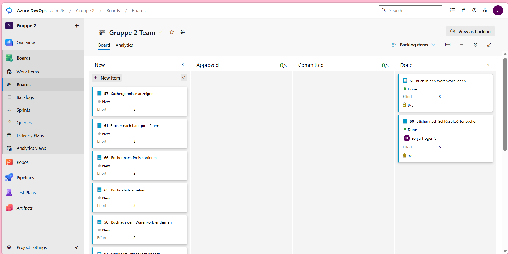

# Teststrategie Buchsuche

**Story:** #50 Bücher nach Schlüsselwörter suchen · **Sprint:** Sprint 1 · **Task:** #98

## Ziel

Wir wollen sicherstellen, dass die Buchsuche die Anforderungen erfüllt:

1. Gesucht wird in **Titel**, **Beschreibung** und **Autor**.
2. **Alle** Schlüsselwörter müssen vorkommen – jedes darf aber in einem anderen Feld stehen.
3. Die Suche ist **case-insensitive**.
4. Die REST-Schnittstelle (`GET /api/books?keywords=...`) liefert die Treffer als **JSON**.

## Testpyramide

Wir testen auf drei Ebenen. Unten viele schnelle Tests, oben wenige, die das Ganze prüfen.

| Ebene | Was wird getestet? | Werkzeug | Testklasse |
|---|---|---|---|
| **Repository-Tests** (viele) | Die Suchlogik gegen eine echte H2-Datenbank mit eigenen Testdaten | JUnit 5, `@DataJpaTest`, AssertJ | `BookRepositoryTest` |
| **Controller-Tests** (einige) | HTTP-Schnittstelle: URL, Parameter, Statuscode, JSON-Format. Das Repository wird gemockt. | `@WebMvcTest`, MockMvc, Mockito | `BookRestControllerTest` |
| **Integrationstest** (wenige) | Ganzer Ablauf: HTTP-Anfrage → Controller → Repository → H2 mit `data.sql` | `@SpringBootTest(webEnvironment = RANDOM_PORT)`, TestRestTemplate (echtes HTTP auf zufälligem Port) | `CatalogApplicationIntegrationTest` |
| **E2E-Test** (Order-Service) | Ganzer Ablauf im Browser: Suche auf `localhost:8081`, Bücher prüfen, Buch in den Warenkorb legen, Warenkorb prüfen | Playwright | `CatalogPageE2EIT` (Repo order) |
| **Lasttest** | 100 gleichzeitige Anfragen auf `/api/books?keywords=`, alle müssen erfolgreich sein | Gatling | `BookSearchSimulation` |
| **Manueller Test** | Kurzer Rauchtest im Browser bzw. mit Postman | Browser, Postman, H2-Konsole | – |

## Testfälle (Äquivalenzklassen und Grenzfälle)

| Nr. | Testfall | Eingabe | Erwartetes Ergebnis |
|---|---|---|---|
| T1 | Treffer im Titel | `Hobbit` | „Der Hobbit“ |
| T2 | Treffer in der Beschreibung | `Irrenhaus` | „Die Physiker“ |
| T3 | Treffer beim Autor | `Tolkien` | beide Tolkien-Bücher |
| T4 | Gross-/Kleinschreibung egal | `tOLKIEN` | wie T3 |
| T5 | Mehrere Schlüsselwörter (UND) | `Tolkien Ring` | nur „Der Herr der Ringe“ |
| T6 | Schlüsselwörter in verschiedenen Feldern | `hobbit zwerge tolkien` | „Der Hobbit“ |
| T7 | Teilwort | `craft` | „Clean Code“ |
| T8 | Ein Schlüsselwort passt nicht | `Tolkien Dürrenmatt` | leere Liste |
| T9 | Unbekanntes Wort | `Kochbuch` | leere Liste |
| T10 | Leerer Suchbegriff / nur Leerzeichen / kein Parameter | `""`, `"   "` | alle Bücher |
| T11 | Mehrere Leerzeichen zwischen Wörtern | `"  Tolkien    Ring "` | wie T5 |
| T12 | Umlaute | `DÜRRENMATT physiker` | „Die Physiker“ |
| T13 | JSON-Format | `tolkien` | Status 200, `application/json`, Felder `isbn`, `title`, `description`, `author` |
| T14 | Keine Treffer über REST | `xyz` | Status 200, leeres Array `[]` |

## Testdaten

- **Repository-Tests** verwenden eigene, kleine Testdaten (4 Bücher), die vor jedem Test neu angelegt werden. So sind die Tests unabhängig von `data.sql`.
- **Integrationstest** verwendet die 10 Bücher aus `data.sql`.

## Ausführung

- Lokal: `mvn test` (oder in IntelliJ Rechtsklick auf `src/test/java` → *Run All Tests*).
- Vor jedem Pull Request müssen alle Tests grün sein.
- Lasttest: Catalog starten, dann `mvn gatling:test` (Maven-Fenster → Plugins → gatling → gatling:test). Bericht unter `target/gatling/…/index.html`.
- E2E-Test (Repo order): Catalog (8080) und Order (8081) starten, dann `CatalogPageE2EIT` in IntelliJ ausführen. Der Name endet auf `IT`, damit er bei `mvn test` nicht automatisch läuft.
- Später: Tests automatisch in einer Azure Pipeline bei jedem Pull Request laufen lassen.

## Manueller Rauchtest

1. Anwendung starten (`mvn spring-boot:run`).
2. Im Browser aufrufen:
   - `http://localhost:8080/api/books` → alle 10 Bücher
   - `http://localhost:8080/api/books?keywords=tolkien%20ring` → 1 Buch
3. Optional: Daten in der H2-Konsole prüfen unter `http://localhost:8080/h2-console` (JDBC-URL `jdbc:h2:mem:catalog`, User `sa`).

## Definition of Done (für Story #50)

- Alle Testfälle T1–T14 sind automatisiert und grün.
- Code wurde per Pull Request von einer zweiten Person reviewed.
- Commits sind mit `AB#<Tasknummer>` verknüpft.

## Bekannte Grenzen / mögliche Erweiterungen

- Zeichen wie `%` oder `_` im Suchbegriff werden als SQL-Platzhalter interpretiert.
- Keine Sortierung nach Relevanz und keine Paginierung – kommt mit Story #57 „Suchergebnisse anzeigen“.

- Lasttest und E2E-Test brauchen laufende Anwendungen und laufen deshalb nicht automatisch bei `mvn test`.
